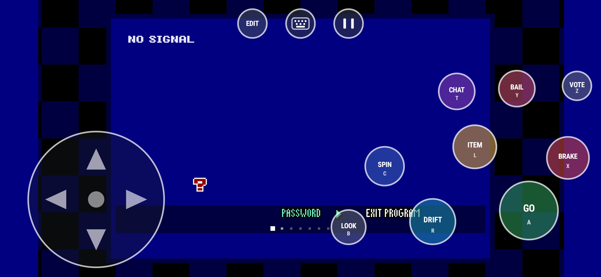
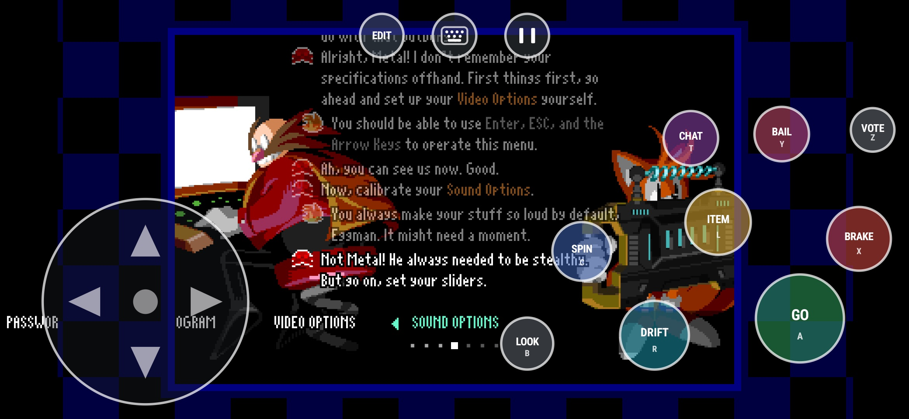
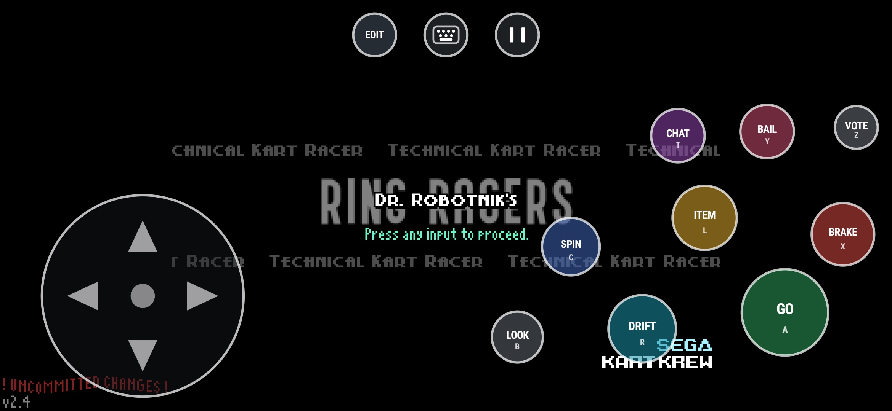

<div align="center">


# Ring Racers for Android

**Dr. Robotnik's Ring Racers v2.4 running natively on Android, in ultrawide.**

The real game engine compiled for ARM64: SDL2, OpenGL ES 2, on-screen touch controls, controller support<br>
and a native-aspect mode that fills your phone's display (19.5:9, 20:9, 21:9…). No emulation, no browser.

<a href="../../releases/latest"></a>


<a href="LICENSE"></a>

<a href="../../releases/latest"></a>
<a href="#%EF%B8%8F-how-it-works"></a>
<a href="#%EF%B8%8F-building-from-source"></a>
<a href="https://www.youtube.com/@belmante"></a>

</div>

---

> [!NOTE]
> Ring Racers is a **free** fan game by [Kart Krew Dev](https://www.kartkrew.org/), and its data files are freely distributed by them. This is an unofficial port: it is **not** made by or endorsed by Kart Krew Dev or SEGA.

## 📸 Screenshots

<div align="center">

| Main menu (19.5:9) | First-time setup |
|:---:|:---:|
|  |  |
|  | |

*Galaxy S23 (2340×1080), rendering at 1040×480 native aspect.*

</div>

## ✨ Features

| | |
|---|---|
| 🚀 **Native** | The Ring Racers v2.4 engine built for ARM64 with the Android NDK. SDL2 for window, input and audio; the engine's own GLES2 RHI presents the frame. |
| 🖥️ **Ultrawide** | The engine only knew a fixed list of 4:3 / 16:10 / 16:9 modes. This port adds modes that match your screen's real aspect ratio (360p, 480p, 540p) and picks the 480p one by default: on a Galaxy S23 that's **1040×480**, edge to edge, under the camera cutout, no stretching and no bars. HUD elements snap to the screen edges; menus stay centred. |
| 🎮 **Touch controls** | D-pad + GO / DRIFT / ITEM / BRAKE / SPIN / LOOK / BAIL / VOTE, chat, pause and keyboard buttons, multitouch. An edit mode lets you drag and resize every control. |
| 🕹️ **Controllers** | USB / Bluetooth controllers work out of the box through SDL's controller database (drift and items on the triggers, like on PC). |
| 🌐 **Online** | Master server and HTTP/HTTPS addon downloads work on Android. |
| 📂 **Addons** | Drop `.pk3` / `.wad` files in `RingRacers/addons` on your phone's storage. |

## 🎮 Controls

| Touch | Game action | Controller (default) |
|---|---|---|
| D-pad | Steer, aim items, trick direction | Left stick / D-pad |
| **GO** | Accelerate · menu accept | A |
| **DRIFT** | Drift | RT |
| **ITEM** | Use item / rings | LT |
| **BRAKE** | Brake · menu back | X |
| **SPIN** | Spindash, fastfall | Y |
| **LOOK** | Look back | B |
| **BAIL** | Ring Bail | LB |
| **VOTE** | Vote (multiplayer) | RB |
| ⏸ | Pause | Start |

The touch buttons send the game's default keyboard binds, so remapping in *Options → Controls* works for them too.

## 📋 Requirements

| | |
|---|---|
| **Device** | Android 9.0+ (API 28), **ARM64** (arm64-v8a), OpenGL ES 2.0 |
| **Storage** | ~1.6 GB free (the game data is ~750 MB and is unpacked on first launch) |
| **Input** | Touch, a controller (Bluetooth/USB) or a keyboard |

## 📲 Installing

1. Download the APK from [**Releases**](../../releases/latest) and install it.
2. Open **Ring Racers**. The first launch unpacks the game data (a few seconds).
3. Race. Profiles, settings, replays and addons live in `RingRacers/` on your phone's storage.

## ⚙️ How it works

```
MainActivity ──► AssetExtractor: bios.pk3 + data/*.pk3 → app storage (first launch)
      │
      ▼
GameActivity (SDLActivity, SDL2 Java) ──► libmain.so = Ring Racers v2.4 engine
      │                                       ├─ software renderer → GLES2 RHI → screen
      └─ TouchControlsView (overlay)          ├─ SDL2 audio / controllers
          → SDL key events                    └─ native-aspect video modes (ultrawide)
```

Engine-side changes are small and live behind `#ifdef __ANDROID__`: a GLES2 context and RHI backend instead of desktop GL 2.1, drawable-size aware presentation, logging to logcat, storage paths, network fixes, tuned draw distances and the ultrawide modes (`src/sdl/i_video.cpp`, `src/screen.c`).

## 🛠️ Building from source

Tested on macOS (Apple Silicon); Windows and Linux work the same way.

```bash
git clone -b android https://github.com/BelmanteGu/RingRacers
cd RingRacers

# 1. Native dependencies for arm64-android (curl, SDL2, libpng, opus, vorbis…)
export ANDROID_NDK_HOME=~/Library/Android/sdk/ndk/28.2.13676358
git clone https://github.com/microsoft/vcpkg ../vcpkg && ../vcpkg/bootstrap-vcpkg.sh
../vcpkg/vcpkg install --triplet arm64-android --x-install-root=../vcpkg_installed

# 2. Ring Racers v2.4 data: unzip Dr.Robotnik.s-Ring-Racers-v2.4-Assets.zip from
#    https://github.com/KartKrewDev/RingRacers/releases/tag/v2.4

# 3. Point the build at everything (android/local.properties)
cat > android/local.properties <<PROPS
sdk.dir=$HOME/Library/Android/sdk
ringRacersData=/path/to/ring-racers-v2.4-assets
vcpkgRoot=$PWD/../vcpkg
vcpkgInstalled=$PWD/../vcpkg_installed
ndkVersion=28.2.13676358
PROPS

# 4. Build and install
cd android && ./gradlew assembleDebug
adb install -r app/build/outputs/apk/debug/app-debug.apk
```

Every setting can also come from `-P<name>=…` or an environment variable (`RINGRACERS_DATA`, `VCPKG_ROOT`, `VCPKG_INSTALLED_DIR`, `ANDROID_NDK_VERSION`).

## 📊 Status

| | |
|:---:|---|
| ✅ | Boots, menus and first-time setup on Galaxy S23 (Snapdragon 8 Gen 2), Android 16 |
| ✅ | Native-aspect ultrawide (1040×480 on 19.5:9), drawn under the cutout |
| ✅ | Touch controls drive the game; controllers through SDL |
| 🚧 | In-race HUD at ultrawide still being checked track by track |
| 🚧 | Software renderer only: OpenGL (3D models) isn't available on Android yet |

Reports from other phones (Mali / Exynos / Tensor GPUs especially) are very welcome. Open an [issue](../../issues).

## 🔎 Other Android ports

There's no official Android build. Community ports this one learned from:

- [thegreatbbd94-ux/ring-racers-srb2-port](https://github.com/thegreatbbd94-ux/ring-racers-srb2-port): GLES2 RHI, touch controls, master server. **This fork builds on its Android work.**
- [Takeshi998/ring-racers-srb2-port](https://github.com/Takeshi998/ring-racers-srb2-port): fork with extra touch combos and Android 9 support.
- Lineage: Ring Racers ← [SRB2Kart](https://github.com/STJr/Kart-Public) ← [Sonic Robo Blast 2](https://srb2.org/) (which had its own Android port by Lactozilla) ← [Doom Legacy](http://doomlegacy.sourceforge.net/).

## ⚖️ Legal

- Source code under the **GNU GPL v2.0 or later**, like upstream. See [LICENSE](LICENSE) and [LICENSE-3RD-PARTY.txt](LICENSE-3RD-PARTY.txt).
- Dr. Robotnik's Ring Racers is a work of fan art made available for free without intent to profit or harm the intellectual property rights of the original works it is based on. Kart Krew Dev is in no way affiliated with SEGA Corporation, and neither is this port. Sonic the Hedgehog and related characters are © SEGA.
- The original upstream README (desktop build instructions, contributing) is in [docs/UPSTREAM_README.md](docs/UPSTREAM_README.md).

## 💜 Credits

- **[Kart Krew Dev](https://www.kartkrew.org/)** for Dr. Robotnik's Ring Racers. Go play it on PC too.
- **thegreatbbd94-ux** and contributors for the Android port this builds on (GLES2 RHI, touch controls, networking).
- Sonic Team Junior for [SRB2](https://srb2.org/), and the Doom Legacy team.
- [SDL](https://libsdl.org/), [vcpkg](https://vcpkg.io/) and the Android NDK.

<div align="center">

Made by <a href="https://github.com/BelmanteGu">Belmante</a> · <a href="https://www.youtube.com/@belmante">Projeto Belmante</a>

</div>
